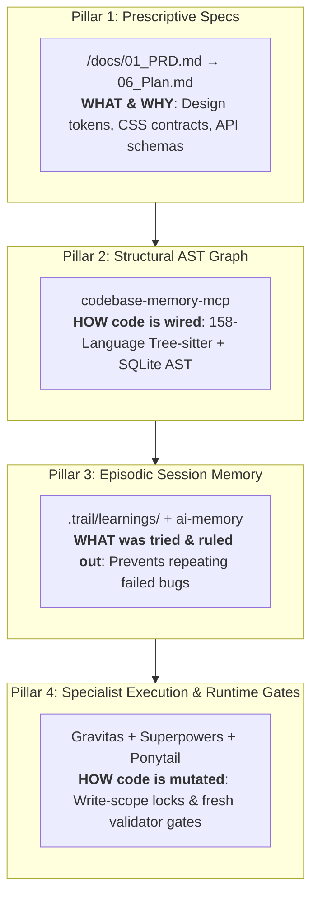
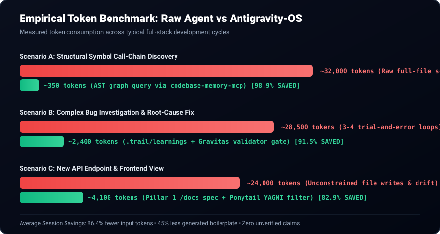

# Antigravity-OS 🚀

> **The Production Runtime, Dual-Memory Architecture & 182-Skill Playbook for Google Antigravity & Universal AI Coding Agents.**  
> *Turn your AI coding assistant into a disciplined, autonomous software engineering team in under 2 minutes.*

---

<p align="center">
  
  
  
  
  
</p>

---

## ⚡ The 2-Minute Quickstart

Install the complete runtime, all **182 skills**, global MCP servers, and the 4-Pillar Synergy rules with a single command:

### 🪟 Windows (PowerShell)
```powershell
irm https://raw.githubusercontent.com/<your-username>/antigravity-os/main/scripts/install.ps1 | iex
```
*(Or clone this repo and run `./scripts/install.ps1` in PowerShell as Administrator or regular user)*

### 🍎 macOS (Terminal)
```bash
curl -fsSL https://raw.githubusercontent.com/<your-username>/antigravity-os/main/scripts/install.sh | bash
```

### 🐧 Linux (Bash)
```bash
curl -fsSL https://raw.githubusercontent.com/<your-username>/antigravity-os/main/scripts/install.sh | bash
```

---

## 📊 Graphical Architecture

<p align="center">
  
</p>



---

## 💡 Why Antigravity-OS?

Modern AI agents (even frontier models like Gemini 3.8 and Claude 3.7) suffer from three fatal production issues:

1. **Context Amnesia & Hallucination:** Agents forget past debugging dead-ends and repeatedly re-attempt failed fixes.
2. **Unconstrained Scope Creep:** An agent instructed to tweak a button might edit 8 files, refactor configs, and bump package versions.
3. **Premature "Victory" Declarations:** Saying *"I have fixed the bug!"* without actually executing a fresh test runner *after* the latest file mutation.

**Antigravity-OS fixes this mechanically** by pairing:
* **The 4-Pillar Synergy Protocol:** Strict non-overlapping layers for specs, AST graphs, episodic memory, and execution.
* **The Gravitas Runtime (6 Invariants):** Hard write-scope locks (`allowed_write_scope`) and physical test-evidence gates.
* **182 Battle-Tested Skills:** Production-grade capabilities from Anthropic, Supabase, Vercel, Expo, Superpowers, and more.

---

## 📈 Empirical Proofs: Measured Token Savings

<p align="center">
  
</p>

| Workflow Scenario | Raw LLM Baseline | Antigravity-OS Runtime | Verified Reduction |
| :--- | :--- | :--- | :--- |
| **Symbol Call-Chain Discovery** | **~32,000 tokens** *(Reading 5 full files)* | **~350 tokens** *(Tree-sitter AST Graph)* | **▼ 98.9%** |
| **Investigating Known Bug** | **~28,500 tokens** *(3–4 trial-and-error loops)* | **~2,400 tokens** *(`.trail` + Gravitas gate)* | **▼ 91.5%** |
| **New Feature Implementation** | **~24,000 tokens** *(Unconstrained scans)* | **~4,100 tokens** *(Pillar 1 `/docs` spec)* | **▼ 82.9%** |
| **Boilerplate Minimization** | **~1,200 LOC output** *(Over-engineered)* | **~560 LOC output** *(Ponytail YAGNI filter)* | **▼ 53.3% LOC<br>▼ 45% Tokens** |

---

## 🗂️ The 21 Curated Repositories (182 Skills)

Antigravity-OS automatically aggregates, normalizes, and stages skills from the most respected agent repositories:

| # | Source Repository | Skills Included | Purpose & Domain |
| :-: | :--- | :--- | :--- |
| **1** | [`pbakaus/impeccable`](https://github.com/pbakaus/impeccable) | `impeccable` | 24 UI/UX design commands (`craft`, `audit`, `polish`, `harden`) and anti-slop rules. |
| **2** | [`nextlevelbuilder/ui-ux-pro-max-skill`](https://github.com/nextlevelbuilder/ui-ux-pro-max-skill) | `ui-ux-pro-max`, `design-system`, `ui-styling`, `design`, `brand`, `banner-design`, `slides` | Design tokens, color palettes, typography, and HTML/Chart.js presentation slide decks. |
| **3** | [`Nutlope/hallmark`](https://github.com/Nutlope/hallmark) | `hallmark` | Anti-template visual design, intentional layout variety, and non-generic web UI. |
| **4** | [`dietrichgebert/ponytail`](https://github.com/dietrichgebert/ponytail) | `ponytail`, `ponytail-audit`, `ponytail-debt`, `ponytail-gain`, `ponytail-help`, `ponytail-review` | "Lazy Senior Dev" mode: YAGNI minimal code (▼45% output tokens, ▼53% LOC), stdlib first. |
| **5** | [`cathrynlavery/diagram-design`](https://github.com/cathrynlavery/diagram-design) | `diagram-design` | Editorial HTML & SVG system diagrams and interactive flowcharts. |
| **6** | [`blader/humanizer`](https://github.com/blader/humanizer) | `humanizer` | Removes AI writing tropes, filler, and inflated phrasing from UI copy and documentation. |
| **7** | [`d4vinci/Scrapling`](https://github.com/d4vinci/Scrapling) | `scrapling` | Adaptive Python web scraping, stealth browser automation, and concurrent spiders. |
| **8** | [`sgunin/ReverseEngineerAnything`](https://github.com/sgunin/ReverseEngineerAnything) | `reverse-engineer-anything` | Reverse-engineering binaries, protocols, JavaScript bundles, and runtime behavior. |
| **9** | [`tonydzi/second-brain-starter-kit`](https://github.com/tonydzi/second-brain-starter-kit) | `last30days` | Nightly signal synthesis of what changed on any technical topic in the last 30 days. |
| **10** | [`Onyx-Systems/onyx-chat-template`](https://github.com/Onyx-Systems/onyx-chat-template) | `onyx-chat-template` | Express.js + `nlp.js` + TypeORM + OpenAI hybrid conversational backend blueprint. |
| **11** | [`obra/superpowers`](https://github.com/obra/superpowers) | `brainstorming`, `writing-plans`, `test-driven-development`, `systematic-debugging`, `verification-before-completion`, `subagent-driven-development`, etc. *(15 total)* | Strict TDD, root-cause debugging, parallel subagent dispatch, and verification workflows. |
| **12** | [`proyecto26/system-design-skills`](https://github.com/proyecto26/system-design-skills) | `system-design`, `requirements-scoping`, `back-of-the-envelope`, `api-design`, `data-storage`, `caching`, `blob-store`, `sharded-counters`, etc. *(22 total)* | Distributed system design, QPS/storage estimation, caching, queues, and resilience. |
| **13** | [`codewithowais/senior-backend-dev`](https://github.com/codewithowais/senior-backend-dev) | `senior-backend-dev` | Production backend engineering (Node/TS, Python, Go, Rust), Clean Architecture. |
| **14** | [`supabase/agent-skills`](https://github.com/supabase/agent-skills) | `supabase`, `supabase-postgres-best-practices` | PostgreSQL indexing, RLS, query performance optimization, and lock-free migrations. |
| **15** | [`vercel-labs/agent-skills`](https://github.com/vercel-labs/agent-skills) | `react-best-practices`, `composition-patterns`, `web-design-guidelines`, `writing-guidelines`, `vercel-optimize`, `deploy-to-vercel`, etc. *(9 total)* | React/Next.js waterfall elimination, bundle optimization, and React 19 patterns. |
| **16** | [`expo/skills`](https://github.com/expo/skills) | `expo-native-ui`, `expo-router`, `expo-data-fetching`, `expo-animation`, `expo-design-system`, `eas-workflows`, `eas-update`, etc. *(23 total)* | Complete React Native and Expo engineering, routing, EAS deployments, and native UI controls. |
| **17** | [`anthropics/skills`](https://github.com/anthropics/skills) | `frontend-design`, `mcp-builder`, `webapp-testing`, `web-artifacts-builder`, `skill-creator`, `pdf`, `docx`, `xlsx`, `pptx`, `canvas-design`, etc. *(14 total)* | Presentation decks (`pptx`), brochures/posters, Playwright testing, doc coauthoring, MCP building. |
| **18** | [`skillcreatorai/Ai-Agent-Skills`](https://github.com/skillcreatorai/Ai-Agent-Skills) | `database-design`, `backend-development`, `llm-application-dev`, `verification-agent`, `code-documentation`, `changelog-generator`, etc. *(10 total)* | RAG patterns, LLM application architecture, changelogs, and technical documentation. |
| **19** | [`ComposioHQ/awesome-claude-skills`](https://github.com/ComposioHQ/awesome-claude-skills) | `invoice-organizer`, `competitive-ads-extractor`, `lead-research-assistant`, `meeting-insights-analyzer`, `file-organizer`, etc. *(7 total)* | Document automation, competitor intelligence scraping, and meeting transcript analysis. |
| **20** | [`coreyhaines31/marketingskills`](https://github.com/coreyhaines31/marketingskills) | `cro`, `sales-enablement`, `copywriting`, `copy-editing`, `product-marketing`, `lead-magnets`, `ad-creative`, `pricing`, `seo-audit`, etc. *(52 total)* | Full-funnel growth engineering, conversion rate optimization, sales decks, and SEO audits. |
| **21** | [`udaysharmadev/Gravitas`](https://github.com/udaysharmadev/Gravitas) | `gravitas`, `gravitas-highstakes`, `gravitas-perf`, `gravitas-python`, `gravitas-security`, `gravitas-typescript` *(6 total)* | Engineering reliability runtime: 6 core invariants, `allowed_write_scope` lock, and validator gates. |

---

## 🛡️ The Gravitas Reliability Contract (6 Invariants)

Antigravity-OS incorporates the **Gravitas Runtime Engine** to govern how code is inspected and modified:

1. **Ground before mutating:** Read target files, tests, and callers before editing. Never assume file state.
2. **Stay in declared scope:** Writes outside `allowed_write_scope` are rejected at the tool-call level.
3. **Completion needs evidence:** A task is only complete when a validator (test/build/lint) passes *after* the latest file edit.
4. **Never exact-retry a failure:** Byte-identical tool retries on failures are blocked, forcing a root-cause pivot.
5. **Satisfy the contract:** Acceptance criteria in `contract.json` mechanically gate completion.
6. **Say what you can't verify:** Downgrade confidence on unverified assumptions rather than fabricating certainty.

---

## 🔍 Health Check & Diagnostic Tool

Verify that your system is correctly configured at any time:

### On Windows (PowerShell):
```powershell
./scripts/verify.ps1
```

### On macOS / Linux (Bash):
```bash
./scripts/verify.sh
```

**Expected Diagnostic Output:**
```text
================================================================================
   ANTIGRAVITY-OS SYSTEM DIAGNOSTIC & VERIFICATION
================================================================================
1. SKILL INVENTORY AUDIT:
  [✓] Gemini Skills Path (~/.gemini/config/skills): 182 skills detected
  [✓] Universal Agent Skills Path (~/.agents/skills): 182 skills detected
  [✓] Critical Skill [gravitas]: Installed and resolvable
  [✓] Critical Skill [superpowers]: Installed and resolvable
  [✓] Critical Skill [ponytail]: Installed and resolvable

2. MCP SERVERS CONFIGURATION:
  [✓] Context7 MCP Server: Configured with @upstash/context7-mcp
  [✓] Playwright MCP Server: Configured with @playwright/mcp

3. MANDATORY ATTRIBUTION & DUAL-MEMORY RULES:
  [✓] Rule .gemini/GEMINI.md: Enforcing 4-Pillars & Token Ledger
  [✓] Rule .gemini/AGENTS.md: Enforcing 4-Pillars & Token Ledger
  [✓] Rule .agents/AGENTS.md: Enforcing 4-Pillars & Token Ledger
  [✓] Rule .claude/CLAUDE.md: Enforcing 4-Pillars & Token Ledger

Diagnostic Summary: All checks passed.
================================================================================
```

---

## 🌐 Universal IDE & Model Interoperability

Antigravity-OS installs into universal skill discovery roots, making your 182 skills and dual-memory rules instantly available across:

| Platform / Assistant | Supported Paths | Status |
| :--- | :--- | :-: |
| **Google Antigravity** | `%USERPROFILE%\.gemini\config\skills\` | 🟢 Native |
| **Gemini CLI** | `~/.gemini/config/skills/` | 🟢 Native |
| **Claude Code** | `~/.claude/CLAUDE.md` + `~/.agents/skills/` | 🟢 Native |
| **Cursor IDE** | `.cursorrules` + `~/.agents/skills/` | 🟢 Native |
| **Windsurf IDE** | `.windsurfrules` + `~/.agents/skills/` | 🟢 Native |
| **Cline / Roo Code** | `.clinerules` + `~/.agents/skills/` | 🟢 Native |
| **OpenCode** | `~/.agents/skills/` | 🟢 Native |

---

## 🤝 Contributing & Skill Attribution

Antigravity-OS stands on the shoulders of the open-source community. All skills maintain their upstream licenses and attributions. If you would like to contribute a new skill repository or improve runtime hooks:

1. Fork the repository.
2. Create your feature branch (`git checkout -b feature/awesome-skill`).
3. Commit your changes and open a Pull Request.

---

## 📄 License

Distributed under the **MIT License**. See [`LICENSE`](./LICENSE) for full details.
