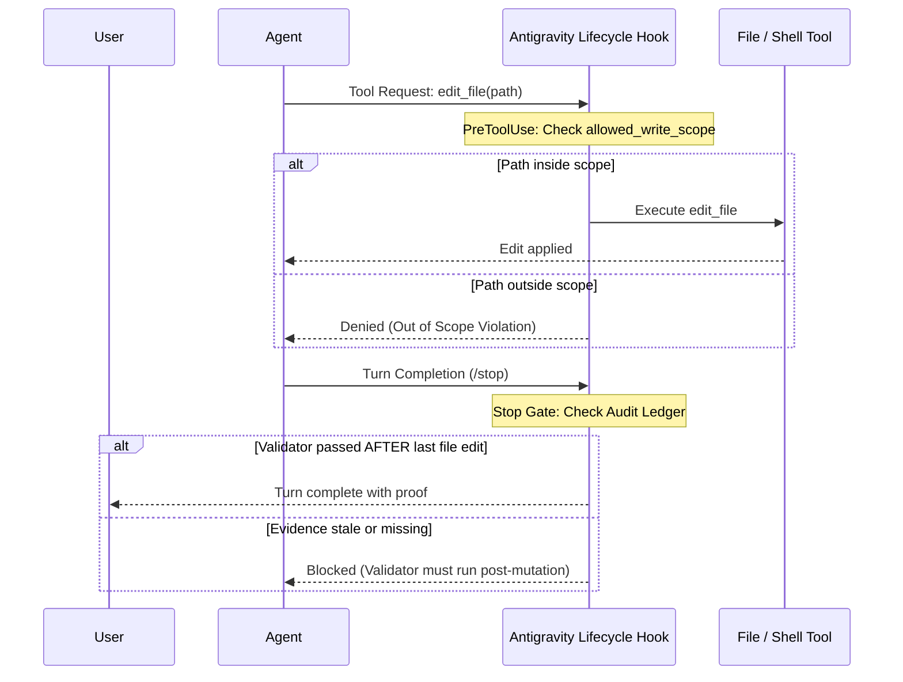

# 04. The Gravitas Reliability Runtime

## Background

Most LLM coding agents fail because prompt guidelines are **soft constraints**. Under long context windows or iterative debugging cycles, instructions easily degrade, causing the agent to:
1. Declare a bug resolved without running a test after the latest edit.
2. Edit files outside the intended task boundary.
3. Enter repetitive retry spirals when seeing the same compiler error.

**Gravitas** (created by `@udaysharmadev`) replaces soft prompt suggestions with **mechanical host-level gates**. In Antigravity-OS, Gravitas serves as the execution runtime engine for **Pillar 4**.

---

## The 6 Core Invariants

1. **Ground before mutating.** Read the target files, their tests, and their callers before editing. Never act on assumed file state.
2. **Stay in declared scope.** Writes outside `allowed_write_scope` are denied. If the scope is wrong, amend the contract—never route around it.
3. **Completion needs evidence.** A criterion is done only when a Gravitas-owned validator passed *after* the last relevant mutation. Stale evidence, self-reviews, and prose summaries are rejected.
4. **Never exact-retry a failure.** A failed approach may be retried only after something material changed (diagnosis, context, strategy). Byte-identical retries are blocked.
5. **Satisfy the contract.** Acceptance criteria and required validators in `contract.json` gate completion. Generic "tests passed" does not satisfy unrelated criteria.
6. **Say what you can't verify.** Explicitly flag unproven assertions. Downgrade confidence instead of fabricating certainty.

---

## Antigravity Native Hook Integration

Gravitas integrates directly with Google Antigravity lifecycle hooks:

---

## The Specialized Skill Family

* `gravitas`: Core engineering protocol, reconnaissance patterns, and multi-agent coordination.
* `gravitas-highstakes`: Strict checklist for schema migrations, auth changes, and destructive operations.
* `gravitas-perf`: Latency regression guards and benchmark verification.
* `gravitas-security`: OWASP Top 10 checks, secret leak detection, and boundary validation.
* `gravitas-python`: Python testing (`pytest`), linting (`ruff`), and static typing (`mypy`).
* `gravitas-typescript`: TypeScript/Node compilation (`tsc`), linting (`eslint`), and test runners (`vitest`, `jest`).
